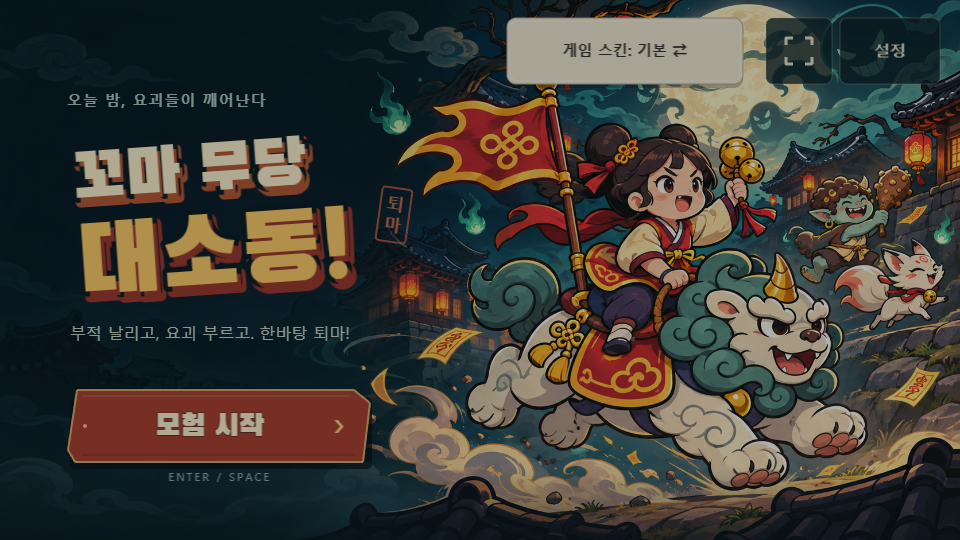
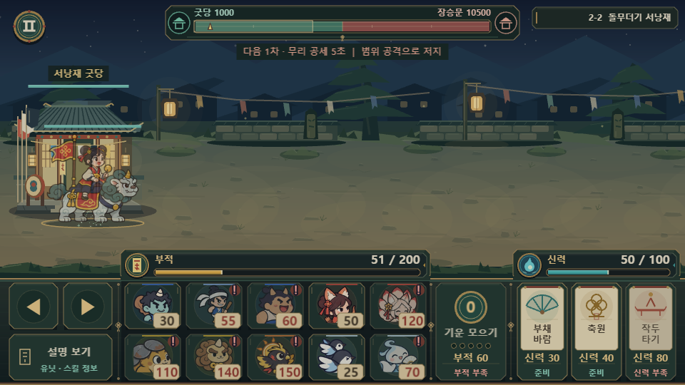

# 꼬마 무당 대소동

요괴 마을 축제 날 밤, 꼬마 무당이 부적을 날리고 요괴를 불러 원귀의 성을 무너뜨리는 **사이드 스크롤 레인 디펜스** 웹 게임입니다.

**▶ 플레이: https://park-jong.github.io/lanebattle/** (PC 브라우저, 휴대폰 가로 화면)





## 게임 방법

- 왼쪽 서낭당에서 출발해 오른쪽 **원귀의 성**을 부수면 승리, 서낭당이 무너지면 패배합니다.
- 시간이 지나면 차오르는 **부적**으로 아군 요괴를 소환합니다. 요괴는 자동으로 전진하며 싸웁니다.
- 꼬마 무당은 직접 움직이며 **신력**으로 스킬(부채 바람·축원·작두 타기)을 씁니다.
- 적은 웨이브 단위로 몰려오고, 성 체력이 80·60·40·20·5% 아래로 떨어질 때마다 **대규모 웨이브**가 나옵니다.
- 5개 장·25개 관문이 있고, 각 장 마지막 관문에는 보스가 등장합니다. 클리어하면 별(최대 3개)과 재화를 얻어 빌드 화면에서 영웅·요괴를 강화합니다.

### 조작

| 키 | 동작 |
|----|------|
| `A` `D` / `←` `→` | 꼬마 무당 이동 |
| `1` ~ `0` | 요괴 소환 |
| `Q` `W` `E` | 스킬 |
| `R` | 기운 모으기 (결과 화면에서는 다시 하기) |
| `I` | 유닛·스킬 설명 보기 |
| `Esc` / `P` | 일시정지 |

휴대폰에서는 화면의 버튼을 눌러 같은 조작을 할 수 있고, 전체화면 버튼으로 가로 전체화면을 켤 수 있습니다.

## 개발

Phaser 4 + TypeScript + Vite, 테스트는 Vitest를 씁니다.

```bash
npm install
npm run dev        # 개발 서버 (http://localhost:5173/lanebattle/)
npm test           # 단위 테스트
npm run build      # 타입 검사 + 빌드 (dist/)
npm run deploy     # 테스트·빌드 후 GitHub Pages(gh-pages 브랜치)에 배포
```

개발 서버에서 `?stage=N`(0~24)을 붙이면 타이틀을 건너뛰고 그 관문 전투로 바로 들어갑니다.

### 폴더 구성

| 경로 | 내용 |
|------|------|
| `src/battle/` | 전투 규칙 (화면과 분리된 순수 로직) |
| `src/data/` | 유닛·적·스테이지·웨이브 등 수치 데이터 |
| `src/game/` | 저장, 재화, 빌드 등 판 밖 상태 |
| `src/scenes/`, `src/ui/`, `src/render/` | Phaser 화면, UI, 캐릭터 렌더링 |
| `public/assets/` | 게임이 실제로 불러오는 이미지·폰트 |
| `docs/` | 기획(`design.md`), 수치(`numbers.md`), 아트 기록 |
| `scripts/` | 아트 원본을 게임용 아틀라스로 묶는 스크립트 등 |

아트 생성 원본(`output/`)은 용량이 커서 저장소에 올리지 않습니다. 게임용 이미지는 `scripts/`의 패키징 스크립트로 원본에서 다시 만들 수 있습니다.

변경 내역은 [CHANGELOG.md](CHANGELOG.md)를 봐 주세요.
